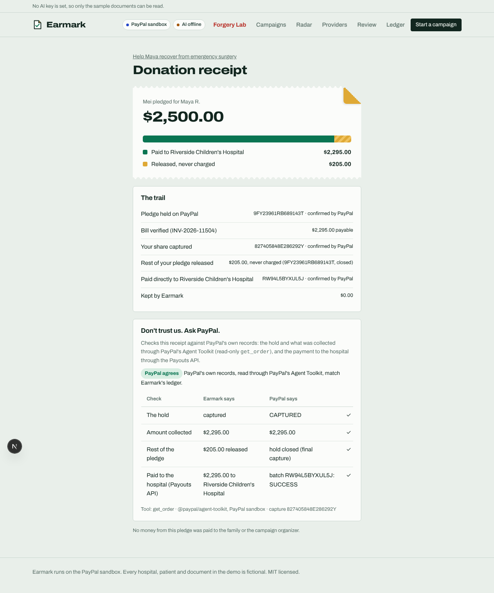

# Live PayPal sandbox run (Nov 1, 2026)

Earmark was run end to end against the real PayPal sandbox. A test donor approved each pledge on
PayPal's own checkout page. Everything after that ran through Earmark's server, and every result
below was read back from PayPal.

## Run 1: pledge smaller than the bill (all of it collected)

| Step | PayPal API | PayPal object | PayPal says |
|---|---|---|---|
| Grace pledges $500, approved on PayPal | Orders v2 `intent=AUTHORIZE` | order `25A265031R7508302` | COMPLETED |
| Held, not charged | `POST /v2/checkout/orders/{id}/authorize` | authorization `20960943R1769645D` | held to Nov 30 |
| Bill verified, Grace's share collected | `POST /v2/payments/authorizations/{id}/capture` | capture `1LR73634UC9740441` | COMPLETED, $500.00, final capture |
| Paid only to the hospital | Payouts `POST /v1/payments/payouts` | batch `7SK65UPMGWPLL` | SUCCESS, $500.00 to the hospital's sandbox account |

## Run 2: pledge larger than the bill (partial capture, rest released)

| Step | PayPal object | PayPal says |
|---|---|---|
| Mei pledges $2,500, held | authorization `9FY23961RB689143T` | CAPTURED (closed) |
| $2,295 collected for the $2,295 bill | capture `827405848E286292Y` | COMPLETED, `final_capture: true` |
| $205 released, never charged | same authorization | closed by the final capture |
| Paid to the hospital | batch `RW94L5BYXUL5J` | SUCCESS, $2,295.00 |
| "Don't trust us. Ask PayPal." | `@paypal/agent-toolkit` `get_order` + Payouts API | **PayPal agrees** on all 4 checks |

Kept by Earmark: $0.00. Paid to the family or organizer: $0.00.

## What the live run caught

- **Payouts need a US (or other Payouts-enabled) sandbox business account.** India sandbox accounts
  get `PAYOUT_NOT_AVAILABLE`. The README's setup steps now say to use US sandbox accounts.
- **The witness compared the wrong payee in payout mode.** PayPal collects into Earmark's platform
  account, then Payouts pays the hospital, so the order's payee is never the hospital. The payee is now
  compared only in direct-pay mode; the Payouts row checks the hospital. Regression test in
  `tests/witness.test.ts`.
- **Webhooks can't reach a local server.** The "sync" action reads each object back from PayPal
  instead, so the trail still shows "confirmed by PayPal".
